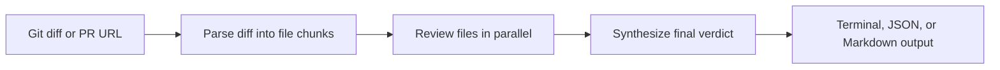

# diff-review

[](https://github.com/machinellabs/diff-review/actions/workflows/ci.yml)

`diff-review` is a command-line tool that reviews git diffs with Claude, the OpenAI API, or a local model you run yourself (Ollama, LM Studio, llama.cpp, vLLM). It works with local diffs, saved patch files, and GitHub pull request URLs.

The goal is simple: get a second pass on a change before merging it, with output that is easy to read in the terminal or reuse in another workflow.

## What it does

- Reviews staged changes, branch diffs, commits, saved `.diff` files, or GitHub PRs
- Splits large diffs at hunk boundaries, dividing oversized hunks without dropping changed lines
- Combines the file-level notes into one final verdict
- Local secrets scan and credential masking in every mode; optional `--security` focuses the model on a security ruleset
- Returns terminal output, JSON, or Markdown
- Includes file names, severity, suggestions, and quoted evidence from the diff
- Prints token usage for each run, with an estimated cost on Claude
- Runs fully offline on local models: the diff never leaves your machine

## How it works



Pipeline:

1. **Parse** - split the diff into file-level chunks
2. **Review** - send file chunks to the model in parallel (8 at a time for hosted APIs, 1 for a local server)
3. **Synthesize** - combine the file reviews into a final verdict

## How to run it

### Install

Use `pipx` for a normal install:

```bash
pipx install git+https://github.com/machinellabs/diff-review
```

On macOS, install `pipx` with:

```bash
brew install pipx
```

For local development:

```bash
git clone https://github.com/machinellabs/diff-review.git
cd diff-review
python -m venv .venv
source .venv/bin/activate
pip install -c requirements-dev.lock -e ".[dev]"
```

### Configure

The default provider is the Claude API. Set an Anthropic API key before running real reviews, or skip this and use a [local model](#local-models):

```bash
export ANTHROPIC_API_KEY=your-key-here
```

For private GitHub repos, or to avoid public API rate limits, set a GitHub token too:

```bash
export GITHUB_TOKEN=your-token-here
```

### Model providers

| Provider | Flag | Needs |
|----------|------|-------|
| Claude (default) | `--provider anthropic` | `ANTHROPIC_API_KEY`; default model `claude-sonnet-5-5` |
| Ollama | `--provider ollama --model NAME` | Ollama running (`OLLAMA_HOST` respected) |
| LM Studio | `--provider lmstudio --model NAME` | LM Studio's local server on port 1234 |
| Any OpenAI-compatible server | `--provider openai --base-url URL --model NAME` | llama.cpp `llama-server`, vLLM, LocalAI, Jan, ... |
| OpenAI API | `--provider openai --model NAME` | `OPENAI_API_KEY` |

Every provider except Claude needs the `openai` extra:

```bash
pipx install 'diff-review[openai] @ git+https://github.com/machinellabs/diff-review'
# or add it to an existing install
pipx inject diff-review openai
```

#### Local models

```bash
ollama pull qwen3.8:27b-q4_K_M
git diff | diff-review --provider ollama --model qwen3.8:27b-q4_K_M

# llama.cpp, vLLM, or any other OpenAI-compatible server
git diff | diff-review --provider openai --base-url http://localhost:8080/v1 --model my-model

# Set it once instead of passing flags
export DIFF_REVIEW_PROVIDER=ollama OPENAI_MODEL=gemma4:26b
```

No API key is needed, nothing is sent off the machine, and no cost estimate is
printed. Local runs are built to hold up with smaller models:

- **Structured output.** Requests carry the review's JSON Schema
  (`response_format: json_schema`), so servers that support constrained
  decoding cannot return malformed or incomplete JSON. Servers that reject it
  fall back to JSON mode, then to prompt-only JSON.
- **Tolerant evidence matching.** Models often re-indent quotes, drop the
  `+`/`-` markers, or elide with `...`. Quotes are matched line by line and
  replaced with the exact lines from the diff, so output evidence is always
  verbatim. See [Review coverage and failures](#review-coverage-and-failures).
- **One request at a time** for servers on localhost, a private network, or
  Tailscale, since most run one generation at a time and queued requests would
  time out. Override with `--concurrency N`. Requests to any custom server time
  out after 30 minutes (`DIFF_REVIEW_TIMEOUT`, in seconds).
- **Thinking control.** `--reasoning none` turns off thinking on reasoning
  models (Qwen 3, gpt-oss, DeepSeek-R1, ...), which is much faster. Reasoning
  tags in replies are stripped either way.

On a Mac Studio, the bundled `examples/insecure.diff` takes about a minute in
`--security` mode with `qwen3.8:27b-q4_K_M --reasoning none` or `gemma4:26b`,
and both report all four planted issues. Review quality tracks the model:
small (7-9B) models complete reviews but over-report severity.

#### Claude

`--model` or `ANTHROPIC_MODEL` picks another Claude model, and `--reasoning
low|medium|high` sets its effort. On current models, a request declined by a
safety classifier is retried on a fallback model automatically (server-side
fallback, Claude API only). If the whole chain declines, the run stops with
the refusal category. Security tooling can occasionally trip the cyber
classifier; Anthropic's Cyber Verification Program covers legitimate
security work.

### Run

Review a GitHub pull request:

```bash
diff-review --pr https://github.com/owner/repo/pull/123
```

Review local changes:

```bash
git diff --cached | diff-review
git diff main...HEAD | diff-review
git show HEAD | diff-review
```

Save Markdown or JSON output:

```bash
git diff main...HEAD | diff-review --markdown --output review.md
git diff main...HEAD | diff-review --json --output review.json
```

### Security review mode

`--security` switches the review to an application-security lens:

```bash
git diff main...HEAD | diff-review --security
diff-review --pr https://github.com/owner/repo/pull/123 --security
```

In this mode the reviewer only reports security-relevant findings, judged
against a fixed ruleset:

| Rule | Focus |
|------|-------|
| `SEC-INJ` | SQL, command, and template injection |
| `SEC-SECRET` | Hardcoded keys, tokens, and passwords |
| `SEC-AUTHZ` | Weakened permission or ownership checks |
| `SEC-DESER` | Unsafe deserialization of untrusted data |
| `SEC-PATH` | Path traversal |
| `SEC-SSRF` | Server-side request forgery |
| `SEC-CRYPTO` | Weak hashing, bad modes, disabled TLS checks |
| `SEC-XSS` | Unescaped output into HTML |

Each issue is tagged with its rule ID in the terminal table, Markdown, and
JSON output.

Every review runs a local regex pre-scan of the added lines for
committed secrets (AWS keys, GitHub/Slack/Anthropic tokens, private key
blocks, credential assignments). Those findings are merged into the review
deterministically. A detected high-severity credential produces `REQUEST_CHANGES`,
and a possible credential prevents an `APPROVE` verdict even if the model misses it.

Recognized credentials are replaced with `[REDACTED]` before the diff is sent
to any model and in report output, including private-key bodies. The scanner
checks placeholder **values**, so comments and environment-variable fallbacks
do not suppress token detection. Redaction is pattern-based and can miss
unrecognized secrets. With a hosted provider (Claude or the OpenAI API), the
redacted diff still leaves your machine; use a [local model](#local-models) for
sensitive changes. There is no raw-credential bypass flag.

To see it in action, review the intentionally vulnerable example diff:

```bash
diff-review --security examples/insecure.diff
```

### Test

From a development checkout:

```bash
pytest
```

Tests mock model requests and need no API key or model server. `requirements-dev.lock` pins
the development/CI environment across Python 3.11–3.14. Refresh it deliberately
with `uv pip compile --universal --python-version 3.11 --extra dev pyproject.toml -o requirements-dev.lock`.
Integration tests run the installed CLI and real Anthropic SDK against a local
HTTP server with dummy credentials. Patch stress tests reconstruct randomized
changes with `git apply`; Git must be available when running the tests.

## Review coverage and failures

Reports include a `coverage` object in JSON and a coverage section in terminal
and Markdown output. It lists reviewed files, excluded files, and the number
of reviewed chunks. Lockfiles, minified assets, and binary patches are excluded
from model review. Exclusion matching uses exact basenames or suffixes.

An excluded file makes coverage incomplete: the verdict cannot be `APPROVE`.
If every file is excluded, the local secrets scan still runs without an API
key and returns `NEEDS_DISCUSSION` or `REQUEST_CHANGES`.

Large files are split into chunks of at most 300 lines and 24,000 UTF-8 bytes,
with file headers and updated hunk ranges. Oversized individual lines fail
explicitly. Combined file-review JSON is limited to 100,000 bytes for synthesis;
larger results require reviewing a smaller diff. No changed lines are silently
truncated to meet these limits.
Malformed or truncated input hunks are rejected before review, even for files
that would otherwise be excluded. Context-only fragments created by splitting
are omitted; every added and removed line is retained.

Each model response is validated, including verdict/severity values, file paths,
and evidence quotes. Invalid or incomplete responses get one additional attempt.
A persistent schema failure, refusal, or API error stops the run without a
verdict; file reviews are never silently dropped. Verified high-severity
findings survive synthesis. Complete coverage means every eligible chunk was
processed, not that the model found every possible bug.

Every finding must quote the diff. Quotes are matched line by line, ignoring
diff markers, indentation, `line N:` labels and `...` elisions, and are then
replaced with the exact lines they match. A finding whose quote still matches
nothing after the retry is discarded rather than reported. Discarded findings
are counted in `coverage.unverified_findings` and noted in the summary, and a
discarded high-severity finding prevents an `APPROVE` verdict.

For CI gating:

```bash
git diff main...HEAD | diff-review --json --fail-on non-approval
```

`--fail-on request_changes` rejects that verdict only; `--fail-on non-approval`
also rejects `NEEDS_DISCUSSION`, including incomplete coverage. Reports are
written before a policy failure exits. The default `--fail-on never` retains
advisory behavior.

| Exit code | Meaning |
|-----------|---------|
| `0` | Review completed (advisory) |
| `1` | Operational failure: bad input, missing key or model, API or server error, refusal, or both `--pr` and a diff file |
| `2` | Verdict-policy failure, or an invalid flag or flag value |
| `130` | Cancelled |

## Example output

```text
╭──────────────────────────────── Verdict ─────────────────────────────────╮
│ REQUEST_CHANGES                                                          │
╰──────────────────────────────────────────────────────────────────────────╯

Summary
The changes introduce a new caching layer but the TTL logic has an off-by-one
error and there is no test coverage for the expiry path.

Model coverage: complete — 2 files, 2 chunks.

  Severity   File           Issue              Suggestion          Evidence
 ────────────────────────────────────────────────────────────────────────────
  high       src/cache.py   TTL comparison     Change to >= to     +    if elapsed
                            uses > not >=      include boundary    > ttl:
  medium     src/cache.py   No test for        Add a test with a   +def get(self,
                            expired entries    frozen clock        key):

Highlights
  ✓ Clean separation between cache interface and storage backend
  ✓ Good use of type hints throughout

Tokens — reviews: 1,842 in / 398 out  | synthesis: 3,201 in / 287 out  | total: 5,043 in / 685 out  (~$0.0169)
```

In `--security` mode the table also has a Rule column.

Verdicts:

- `APPROVE` - looks good to merge
- `REQUEST_CHANGES` - issues should be addressed first
- `NEEDS_DISCUSSION` - needs a human call

## JSON output

```bash
git diff main...HEAD | diff-review --json
```

```json
{
  "issues": [
    {
      "severity": "high",
      "file": "src/cache.py",
      "description": "TTL comparison uses > not >=",
      "suggestion": "Change to >= to include boundary",
      "evidence": "+    if elapsed > ttl:",
      "rule": ""
    }
  ],
  "highlights": ["Clean separation between cache interface and storage backend"],
  "verdict": "request_changes",
  "summary": "...",
  "coverage": {
    "complete": true,
    "reviewed_files": ["src/cache.py", "tests/test_cache.py"],
    "skipped_files": [],
    "reviewed_chunks": 2,
    "unverified_findings": 0
  }
}
```

`rule` holds a rule ID such as `SEC-INJ` in `--security` mode and is empty
otherwise. `coverage` is described in
[Review coverage and failures](#review-coverage-and-failures).

## Markdown output

Markdown output is useful for saving a review or pasting it into a GitHub comment:

```bash
git diff main...HEAD | diff-review --markdown
git diff main...HEAD | diff-review --markdown --output review.md
diff-review --pr https://github.com/owner/repo/pull/123 --markdown --output review.md
```

## Token usage

Every terminal run prints a per-phase token breakdown, with a cost estimate
when the model's pricing is known: Claude models at first-party list prices.
The estimate is omitted for local and OpenAI-compatible endpoints, where
pricing varies by model and server:

```text
Tokens — reviews: 1,842 in / 398 out  | synthesis: 3,201 in / 287 out  | total: 5,043 in / 685 out  (~$0.0169)
```

That estimate is at `claude-sonnet-5-5` prices ($2 / $10 per million input /
output tokens). Prices are built in for current Claude models; another model
set through `ANTHROPIC_MODEL` shows tokens without a cost.

Token usage is not included in `--json` or `--markdown` output, so saved artifacts stay clean.

## Git aliases

```ini
[alias]
  review         = "!git diff main...HEAD | diff-review"
  review-staged  = "!git diff --cached | diff-review"
  review-last    = "!git show HEAD | diff-review"
```

Then use:

```bash
git review
git review-staged
git review-last
```

## GitHub Actions example

```yaml
- uses: actions/checkout@v4
  with:
    fetch-depth: 0  # the base branch must be available to diff against
- run: pipx install git+https://github.com/machinellabs/diff-review
- name: AI code review
  run: |
    git diff "origin/${{ github.base_ref }}...HEAD" \
      | diff-review --markdown --output review.md --fail-on request_changes
    cat review.md >> "$GITHUB_STEP_SUMMARY"
  env:
    ANTHROPIC_API_KEY: ${{ secrets.ANTHROPIC_API_KEY }}
```

On a self-hosted runner with a model server, use `--provider ollama --model
NAME` instead and no secret is needed.

This repo reviews its own pull requests with the workflow in
[`.github/workflows/review.yml`](.github/workflows/review.yml) — the Markdown
review shows up in the job summary of each PR.

## Development

For local development, use the install-from-source commands above, then run `pytest`.

## Configuration

| Environment variable   | Default                  | Description                                                |
|------------------------|--------------------------|------------------------------------------------------------|
| `DIFF_REVIEW_PROVIDER` | `anthropic`              | `anthropic`, `openai`, `ollama`, or `lmstudio`             |
| `DIFF_REVIEW_REASONING`| *(model default)*        | `none`, `low`, `medium`, or `high`                         |
| `DIFF_REVIEW_TIMEOUT`  | `1800` custom server, `600` OpenAI | Per-request timeout in seconds (OpenAI-compatible) |
| `ANTHROPIC_API_KEY`    | *(required for Claude)*  | Anthropic API key (`ANTHROPIC_AUTH_TOKEN` also accepted)   |
| `ANTHROPIC_MODEL`      | `claude-sonnet-5-5`      | Claude model                                               |
| `ANTHROPIC_BASE_URL`   | *(Claude API)*           | Proxy or gateway; turns off the server-side refusal fallback |
| `OPENAI_MODEL`         | *(required)*             | Model for `openai`, `ollama`, and `lmstudio`               |
| `OPENAI_BASE_URL`      | *(preset or OpenAI)*     | OpenAI-compatible endpoint, e.g. `http://localhost:8080/v1`|
| `OPENAI_API_KEY`       | *(OpenAI API only)*      | Not needed for local servers                               |
| `OLLAMA_HOST`          | `localhost:11434`        | Ollama address for `--provider ollama`                     |
| `GITHUB_TOKEN`         | *(optional)*             | GitHub token for private repos or rate limits              |

The `--provider`, `--model`, `--base-url`, `--reasoning`, and `--concurrency`
flags override the corresponding settings per run.

## Requirements

- Python 3.11+
- `ANTHROPIC_API_KEY` for Claude, or a local model server (no key)
- Git, to run the test suite

## Project structure

```text
diff_review/
├── schema.py     # Pydantic output models + LangGraph state
├── providers.py  # Claude + OpenAI-compatible providers (Ollama, LM Studio, llama.cpp, OpenAI)
├── nodes.py      # Parse, review, synthesize steps
├── diff.py       # File paths, exclusions, and complete hunk splitting
├── security.py   # Local credential detection and redaction
├── graph.py      # LangGraph workflow wiring
├── formatter.py  # Rich terminal display + JSON/Markdown output
├── github.py     # GitHub API client for PR diffs
└── cli.py        # Entry point and argument parsing
```

## Versioning

This project follows [Semantic Versioning](https://semver.org/). See [CHANGELOG.md](CHANGELOG.md) for the full history.

## License

[MIT](LICENSE)
